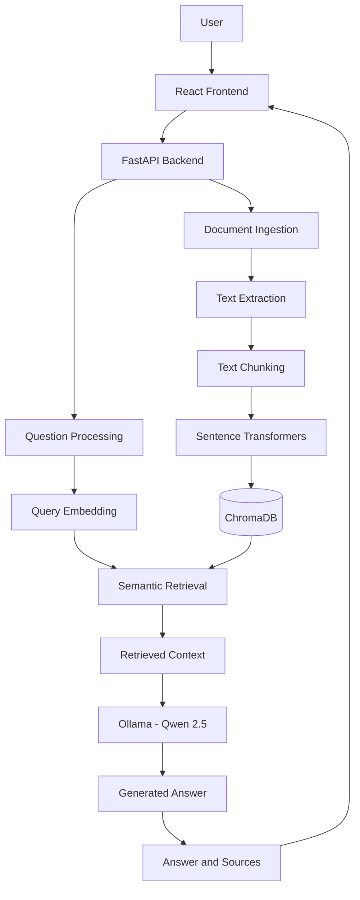

# Enterprise Knowledge Intelligence Platform (RAG)

An AI-powered knowledge intelligence platform that enables users to upload documents, ask natural-language questions, and receive context-aware answers grounded in relevant document content. Built using Retrieval-Augmented Generation (RAG), semantic search, FastAPI, ChromaDB, and a locally running Large Language Model (LLM).

<p align="center">
  <a href="https://github.com/ramritheesh">
    
  </a>
  <a href="https://github.com/ramritheesh/enterprise-knowledge-rag">
    
  </a>
  
  
  
  
  
</p>

<p align="center">
  <strong>Developer:</strong> <a href="https://github.com/ramritheesh">Ram Ritheesh (@ramritheesh)</a> ·
  <a href="https://github.com/ramritheesh/enterprise-knowledge-rag">View Project Repository</a>
</p>

---

## Table of Contents

- [Overview](#overview)
- [Problem Statement](#problem-statement)
- [Key Features](#key-features)
- [Screenshots](#screenshots)
- [System Architecture](#system-architecture)
- [Technology Stack](#technology-stack)
- [How It Works](#how-it-works)
- [Project Structure](#project-structure)
- [Prerequisites](#prerequisites)
- [Installation and Setup](#installation-and-setup)
- [API Endpoints](#api-endpoints)
- [Testing and Evaluation](#testing-and-evaluation)
- [Security and Validation](#security-and-validation)
- [Future Improvements](#future-improvements)
- [Learning Outcomes](#learning-outcomes)
- [Author](#author)
- [License](#license)

---

## Overview

The Enterprise Knowledge Intelligence Platform is a full-stack Generative AI application designed to make information stored in documents easier to access.

Traditional document search often requires users to open multiple files and manually locate relevant information. This project addresses that problem by combining semantic search with a language model to provide answers based on retrieved document content.

Users can upload PDF, DOCX, and TXT documents, ask questions in natural language, and review answers alongside their supporting source passages. The application uses a local language model through Ollama, allowing inference to run locally without requiring a hosted LLM API for answer generation.

**GitHub Profile:** [github.com/ramritheesh](https://github.com/ramritheesh)  
**Project Repository:** [enterprise-knowledge-rag](https://github.com/ramritheesh/enterprise-knowledge-rag)

## Problem Statement

Organizations store policies, reports, manuals, and other important information across multiple documents. Finding a specific answer can be time-consuming, particularly when documents are lengthy or contain overlapping information.

The objective of this project is to build a knowledge assistant that can:

- Process and index uploaded documents.
- Retrieve semantically relevant content for a user question.
- Generate answers using the retrieved context.
- Display source passages to help users verify the answers.
- Provide an interface to upload, view, and delete documents.

## Key Features

### 1. Document Ingestion

- Supports PDF, DOCX, and TXT documents.
- Extracts text from uploaded files.
- Splits extracted content into smaller chunks for retrieval.
- Generates embeddings for semantic search.
- Stores document chunks and metadata in ChromaDB.

### 2. Semantic Search

- Uses Sentence Transformers to generate text embeddings.
- Retrieves relevant passages based on semantic similarity rather than relying only on exact keyword matches.
- Supports configurable retrieval limits through the question-answering API.

### 3. Retrieval-Augmented Generation (RAG)

- Retrieves relevant document chunks before generating an answer.
- Uses retrieved context to help the language model answer questions.
- Uses Qwen 2.5 through Ollama for local LLM inference.
- Returns source passages alongside the generated response.

### 4. Interactive Knowledge Assistant

- Provides a React-based chat interface.
- Allows users to ask questions about indexed documents.
- Displays generated answers and supporting sources.
- Includes suggested questions to help users get started.

### 5. Knowledge Library

- Lists uploaded documents and their indexing status.
- Displays document metadata such as file type and size.
- Supports uploading and deleting documents through the interface.
- Connects to the FastAPI backend for document management.

### 6. Testing and Evaluation

- Includes automated tests for core application functionality.
- Includes scripts to evaluate retrieval quality and answer quality.
- Tests important document ingestion, search, and API workflows.

---

## Screenshots

### Application Dashboard


### RAG Question Answering


### Knowledge Library


### API Documentation


---

## System Architecture

The application follows a full-stack architecture consisting of a React frontend, a FastAPI backend, a vector database, an embedding model, and a local language model.



### Architecture Components

| Component | Responsibility |
|---|---|
| React and Vite | User interface and frontend development server |
| FastAPI | REST API, request validation, and application logic |
| Document ingestion | Extracts text from supported file formats |
| Sentence Transformers | Converts text into vector embeddings |
| ChromaDB | Stores document vectors and supports similarity search |
| Ollama | Runs the language model locally |
| Qwen 2.5 | Generates answers using retrieved context |
| Pytest | Automated testing |
| Evaluation scripts | Measure retrieval and answer quality |

---

## Technology Stack

| Category | Technologies |
|---|---|
| Programming language | Python |
| Frontend | React.js, Vite, JavaScript, CSS |
| Backend | FastAPI, Uvicorn |
| LLM | Qwen 2.5 (0.5B model) |
| LLM runtime | Ollama |
| Embedding model | Sentence Transformers, `all-MiniLM-L6-v2` |
| Vector database | ChromaDB |
| Document processing | pypdf, python-docx |
| API communication | REST APIs, JSON, multipart file upload |
| Testing | Pytest |
| Version control | Git, GitHub |

---

## How It Works

### Step 1: Document Upload

The user uploads a PDF, DOCX, or TXT file through the frontend. The backend validates the file and processes its content.

### Step 2: Text Extraction

The application extracts readable text from the uploaded document using the appropriate document-processing library.

### Step 3: Text Chunking

The extracted text is divided into smaller, overlapping chunks. Chunking helps retrieve relevant sections without passing an entire lengthy document to the language model.

### Step 4: Embedding Generation

The Sentence Transformers model, `all-MiniLM-L6-v2`, converts each chunk into a numerical vector representing its semantic meaning.

### Step 5: Vector Storage

The document chunks, their embeddings, and associated metadata are stored in ChromaDB.

### Step 6: User Question

When the user asks a question, the backend processes the query and retrieves semantically relevant document chunks.

### Step 7: Context-Based Answer Generation

The retrieved passages are supplied as context to the Qwen 2.5 model running through Ollama. The model generates an answer based on the available context.

### Step 8: Answer and Source Display

The frontend displays the answer and supporting document passages, helping users understand where the retrieved information came from.

---

## Project Structure

```text
enterprise-knowledge-rag/
│
├── app/
│   └── main.py
│
├── data/
│   └── documents/
│
├── frontend/
│   ├── src/
│   │   ├── App.jsx
│   │   ├── App.css
│   │   ├── index.css
│   │   └── main.jsx
│   ├── package.json
│   └── ...
│
├── reports/
├── screenshots/
│   ├── dashboard.png
│   ├── rag-answer.png
│   ├── knowledge-library.png
│   └── api-docs.png
│
├── tests/
├── run_evaluation.py
├── evaluate_answers.py
├── evaluate_retrieval.py
├── test_ingestion.py
├── test_vector_search.py
├── .gitignore
└── README.md
```

---

## Prerequisites

Before running the application, install the following:

- Python 3.12 or a compatible Python version supported by the project's dependencies.
- Node.js and npm.
- Git.
- Ollama.
- Sufficient disk space and memory for the embedding model and local language model.

Python 3.13.7 was used during development. If a dependency fails to install on your Python version, use a compatible Python release and create a fresh virtual environment.

---

## Installation and Setup

### 1. Clone the Repository

```bash
git clone https://github.com/ramritheesh/enterprise-knowledge-rag.git
cd enterprise-knowledge-rag
```

### 2. Create a Python Virtual Environment

On macOS or Linux:

```bash
python3 -m venv .venv
source .venv/bin/activate
python -m pip install --upgrade pip
```

### 3. Install Backend Dependencies

```bash
pip install fastapi uvicorn python-multipart pypdf python-docx chromadb sentence-transformers requests pytest
```

If the repository includes a `requirements.txt` file, install from it instead:

```bash
pip install -r requirements.txt
```

### 4. Install Ollama and Download the Model

Download and install Ollama from [ollama.com/download](https://ollama.com/download), then run:

```bash
ollama pull qwen2.5:0.5b
ollama list
```

Ollama generally provides its local API at `http://localhost:11434`. Make sure Ollama is running before asking questions through the application.

### 5. Start the Backend

From the project root, activate the virtual environment if it is not already active and start FastAPI:

```bash
source .venv/bin/activate
python -m uvicorn app.main:app --reload
```

Backend URL: `http://127.0.0.1:8000`  
Interactive API documentation: [http://127.0.0.1:8000/docs](http://127.0.0.1:8000/docs)

Check backend health:

```bash
curl http://127.0.0.1:8000/health
```

Keep this terminal running.

### 6. Install and Start the Frontend

Open a new terminal and run:

```bash
cd frontend
npm install
npm run dev
```

Open the local frontend URL shown by Vite, typically [http://localhost:5173](http://localhost:5173).

---

## API Endpoints

| Method | Endpoint | Purpose |
|---|---|---|
| GET | `/health` | Check backend health |
| POST | `/ask` | Ask a question about indexed documents |
| GET | `/documents` | List available documents and indexing status |
| POST | `/upload` | Upload and index a document |
| DELETE | `/documents/{filename}` | Delete a document |

### Ask a Question

```bash
curl -X POST http://127.0.0.1:8000/ask \
  -H "Content-Type: application/json" \
  -d '{
    "question": "What is the leave policy?",
    "top_k": 3
  }'
```

The response contains the generated answer and supporting source passages.

### List Documents

```bash
curl http://127.0.0.1:8000/documents
```

### Upload a Document

```bash
curl -X POST http://127.0.0.1:8000/upload \
  -F "file=@data/documents/Acme_Employee_Leave_Policy.docx"
```

Replace the example path with the path to a file that exists on your computer.

### Delete a Document

```bash
curl -X DELETE \
  http://127.0.0.1:8000/documents/Acme_Employee_Leave_Policy.docx
```

Use the exact filename returned by the document-listing endpoint.

---

## Testing and Evaluation

### Run Automated Tests

From the project root, run:

```bash
python -m pytest -q
```

The latest recorded development run completed with **27 passing tests**. This is a historical result; rerun the tests after installation or code changes to verify the current environment.

### Run Evaluation Scripts

```bash
python evaluate_retrieval.py
python evaluate_answers.py
python run_evaluation.py
```

### Previously Recorded Evaluation Results

| Metric | Previously recorded result |
|---|---:|
| Retrieval Hit Rate@5 | 100% (18/18 queries) |
| Mean Reciprocal Rank (MRR) | 0.8426 |
| Answer evaluation | 100% (13/13 cases) |

These figures are results from a previous development evaluation run, not independently verified benchmark claims. Results may vary with changes to the documents, evaluation dataset, retrieval settings, model, and code.

- **Hit Rate@5:** The proportion of queries with a relevant result among the top five retrieved passages.
- **Mean Reciprocal Rank (MRR):** Measures how highly the first relevant result appears in the ranking.
- **Answer evaluation:** Measures performance against the criteria implemented in the project's evaluation script.

---

## Security and Validation

The backend includes safeguards for document-management operations, including supported-extension validation, an upload size limit, filename sanitization, question and retrieval-parameter validation, local frontend CORS configuration, and error-handling for indexing and deletion operations.

These safeguards are intended for a local development application. Before enterprise deployment, consider adding authentication, authorization, encrypted storage, audit logging, rate limiting, and stronger file-content validation.

---

## Future Improvements

- **Authentication and authorization:** Add secure login and role-based access control.
- **Multi-user workspaces:** Separate documents and search results by user or organization.
- **Advanced retrieval:** Experiment with hybrid keyword and vector search, reranking, and metadata filtering.
- **Conversation memory:** Support follow-up questions while preserving relevant conversation context.
- **Evaluation improvements:** Expand test datasets and add systematic retrieval and answer-quality metrics.
- **Observability:** Add structured logs, latency tracking, and retrieval diagnostics.
- **Deployment:** Containerize the application and deploy it with suitable production infrastructure.
- **Document support:** Extend ingestion to additional formats and improve extraction from scanned PDFs.
- **Enterprise security:** Add access policies, retention controls, and audit trails.

---

## Learning Outcomes

This project provided practical experience with:

- Designing a Retrieval-Augmented Generation pipeline.
- Understanding document ingestion, chunking, embeddings, and vector search.
- Integrating a locally running LLM into a full-stack application.
- Building REST APIs with FastAPI.
- Connecting a React frontend to a Python backend.
- Managing document uploads and indexing workflows.
- Writing automated tests and evaluating retrieval performance.
- Using Git and GitHub to manage and present a software project.

---

## Author

**Ram Ritheesh**

- **GitHub Profile:** [github.com/ramritheesh](https://github.com/ramritheesh)
- **Project Repository:** [Enterprise Knowledge Intelligence Platform (RAG)](https://github.com/ramritheesh/enterprise-knowledge-rag)

Feel free to explore the repository, review the implementation, and connect through my GitHub profile.

---

## License

Copyright (c) 2026 Ram Ritheesh
